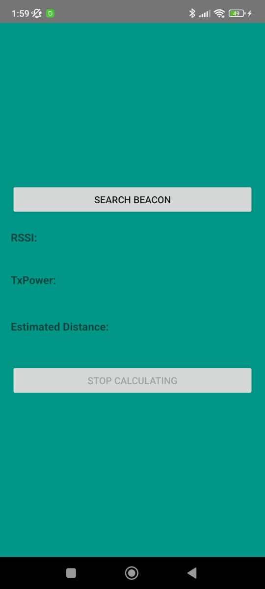
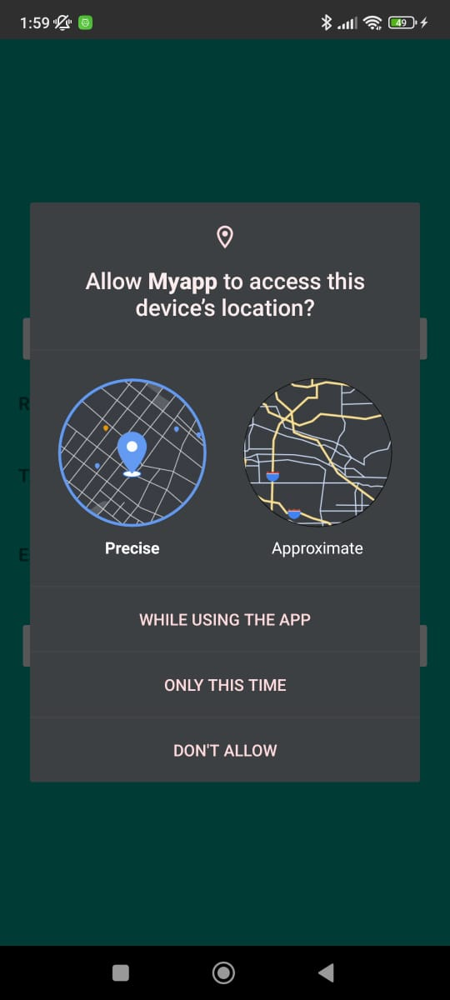
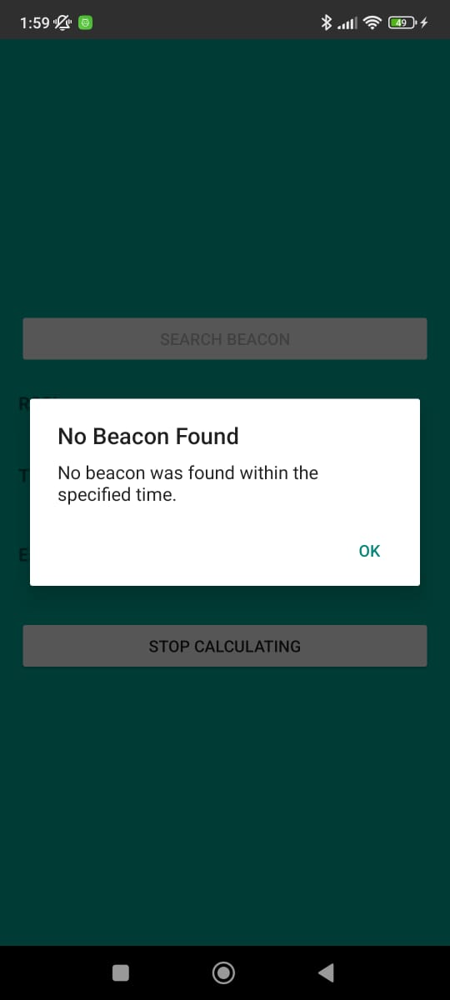

# 📡 BLE Beacon Navigation

### Android BLE Scanning & RSSI-Based Distance Estimation


An Android application developed in **Java** for discovering nearby Bluetooth Low Energy (BLE) advertisers, monitoring signal strength, and estimating proximity using an RSSI-based path-loss model.

This repository contains a **from-scratch reconstruction of a 2023 university project**, based on the author's original technical report.

> **Project status:** The application builds successfully with Gradle 8.7 and JDK 17. The reconstructed implementation has not yet been tested on a physical Android device or BLE beacon.

---

## ✨ Features

- **BLE Discovery:** Scan for nearby Bluetooth Low Energy advertisers.
- **RSSI Monitoring:** Display received signal strength measurements.
- **TxPower Reading:** Retrieve advertised transmission power when available.
- **Distance Estimation:** Estimate proximity using RSSI and TxPower.
- **Device Information:** Display detected Bluetooth device addresses.
- **Scan Controls:** Start and stop BLE scanning.
- **Permission Handling:** Handle missing permissions and disabled Bluetooth.

## 📱 Original Android Prototype (2023)

The following screenshots document the original Android application developed during the 2023 university project.

They show the original scanning interface, Android location permission handling, and the feedback displayed when no beacon was detected.

**These screenshots belong to the original 2023 prototype, not the current reconstructed implementation.**

| BLE Scanning Interface | Location Permission | No Beacon Found |
|:---:|:---:|:---:|
|  |  |  |
| Main screen displaying RSSI, TxPower and estimated distance fields | Android permission request | Feedback when no beacon is detected |

---

## 🛠️ Tech Stack

| Technology | Purpose |
|---|---|
| **Java 17** | Application development |
| **Android SDK** | Native Android platform |
| **Bluetooth Low Energy API** | Device discovery and signal measurements |
| **Gradle 8.7** | Build automation |
| **Android Gradle Plugin 8.5.2** | Android build configuration |
| **Android API 35** | Compile SDK |
| **Android API 23** | Minimum supported SDK |

## ⚙️ How It Works

The application uses Android's Bluetooth Low Energy scanning APIs to discover nearby advertising devices.

The intended scanning workflow is:

1. The user starts a BLE scan.
2. Android reports nearby BLE advertisers.
3. The application reads the received signal strength (RSSI).
4. When advertised TxPower is available, an approximate distance is calculated.
5. The collected measurements are displayed.
6. The user can stop the scan.

### 📐 Distance Estimation

The application uses a simplified logarithmic path-loss model:

$$
d = 10^{\frac{TxPower - RSSI}{10n}}
$$

Where:

- **d:** Estimated distance in meters
- **TxPower:** Reference transmission power in dBm
- **RSSI:** Received Signal Strength Indicator in dBm
- **n:** Path-loss exponent, assumed to be `2`

This model provides an approximate proximity estimate, not an accurate physical distance measurement.

Results depend on signal interference, obstacles, device characteristics, and environmental conditions.

If TxPower is unavailable, the application cannot calculate a distance estimate using this model.

---

## 🚀 Getting Started

### Prerequisites

- JDK 17
- Android SDK Platform 35
- Android SDK Build Tools
- An Android device with BLE support for runtime testing

### 1. Clone the Repository

```bash
git clone https://github.com/cbarda/ble-beacon-navigation.git
cd ble-beacon-navigation
```

### 2. Configure the Android SDK

Set the `ANDROID_HOME` environment variable or create a `local.properties` file in the project root:

```properties
sdk.dir=/path/to/your/Android/Sdk
```

The `local.properties` file is excluded from version control.

### 3. Build the Application

On Linux or macOS:

```bash
./gradlew assembleDebug
```

On Windows:

```powershell
.\gradlew.bat assembleDebug
```

The generated debug APK is located at:

```text
app/build/outputs/apk/debug/app-debug.apk
```

**Build verification:** The project successfully completed `assembleDebug` on Linux using Gradle 8.7 and JDK 17.

### 4. Run the Application

1. Open the project in Android Studio.
2. Allow Gradle to synchronize the project.
3. Connect an Android device with Bluetooth Low Energy support.
4. Enable Bluetooth and grant the required permissions.
5. Launch the application.
6. Tap **SEARCH BEACON** to start scanning.
7. Tap **STOP CALCULATING** to stop scanning.

On Android 6–11, Location Services may also need to be enabled.

> These are the intended usage steps. Runtime behavior has not yet been verified on physical hardware.

---

## 📂 Project Structure

```text
ble-beacon-navigation/
├── app/
│   ├── build.gradle
│   └── src/
│       └── main/
│           ├── AndroidManifest.xml
│           └── java/
│               └── com/example/blebeacon/
│                   └── MainActivity.java
├── docs/
│   └── images/
│       ├── Beacon1.jpeg
│       ├── Beacon2.jpeg
│       └── Beacon4.jpeg
├── gradle/
│   └── wrapper/
│       ├── gradle-wrapper.jar
│       └── gradle-wrapper.properties
├── .gitignore
├── build.gradle
├── gradlew
├── gradlew.bat
├── README.md
└── settings.gradle
```

## ⚠️ Known Limitations

- The scanner detects BLE advertisers, not exclusively iBeacon devices.
- iBeacon-specific manufacturer-data filtering is not implemented.
- Many BLE devices do not advertise TxPower.
- Distance estimation uses a fixed path-loss exponent of `n = 2`.
- RSSI measurements can fluctuate due to interference, obstacles, and device orientation.
- Distance estimates are not suitable for safety-critical navigation.
- Audio guidance, route guidance, and tunnel deployment are not implemented.
- The reconstructed application has not yet been tested on physical Android hardware.

## 🎓 Project Background

This repository revisits a university project developed in **2023**, focused on navigation with the assistance of Bluetooth beacons.

The original technical report, titled *Πλοήγηση με τη βοήθεια beacons* (*Navigation with the Help of Beacons*), documented the project's concept and experimental work.

Because the original source code was unavailable, the Android application was **reimplemented from scratch** using the report as a reference.

The reconstruction demonstrates concepts involving:

- Native Android development with Java
- Bluetooth Low Energy scanning
- Wireless signal strength measurements
- RSSI-based proximity estimation
- Android permission handling
- Gradle-based Android builds

The original BLE hardware belonged to the university laboratory and is not included in this repository.

## 📝 Repository Notes

Local SDK configuration, Gradle caches, generated build files, IDE-specific files, credentials, and private laboratory configuration files are excluded from version control.

This repository contains newly written source code. It does not claim to recover or reproduce the original implementation.

---

**Reconstructed from a 2023 university project using Java, Android, and Bluetooth Low Energy technologies.**
